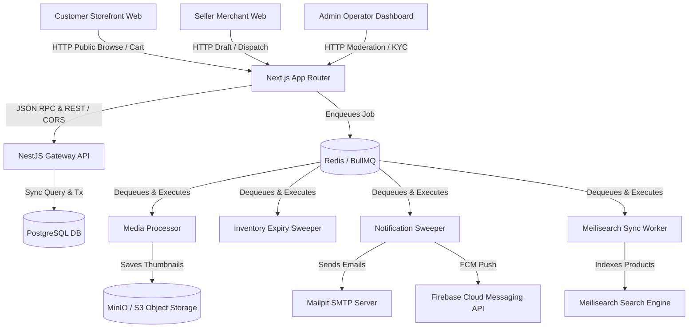
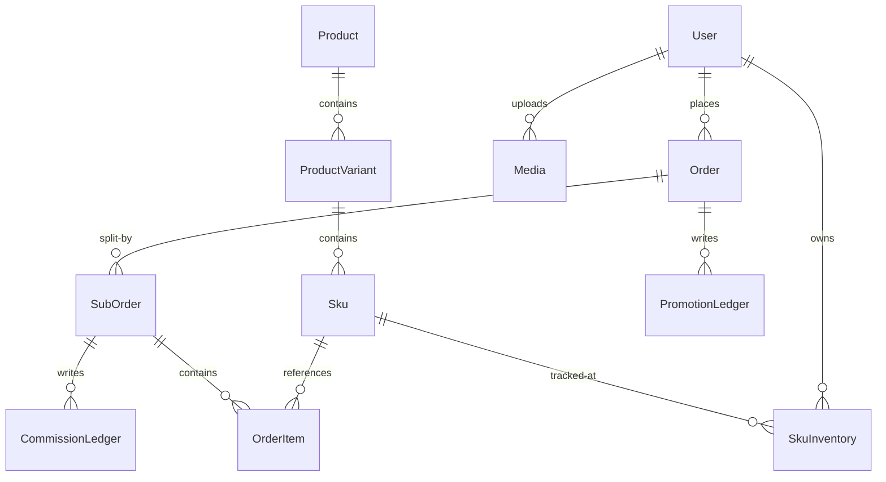
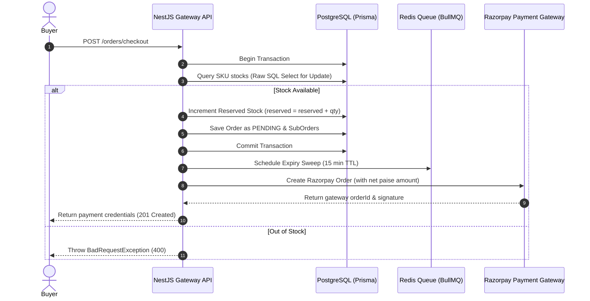
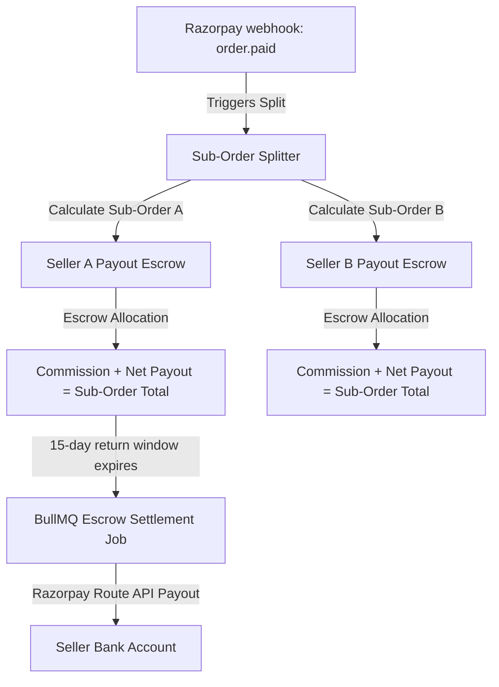

# Multi-Vendor Fashion Marketplace — Complete Reference & Operations Manual

Welcome to the definitive reference manual and deployment handbook for the Multi-Vendor Fashion Marketplace application. This document serves as the comprehensive repository of all system design decisions, data workflows, architectural models, database schemas, remediation achievements, setup runbooks, and deployment checklists. 

---

## Table of Contents
1. [System & Architecture Overview](#1-system--architecture-overview)
2. [Data Models & Schema Registry](#2-data-models--schema-registry)
3. [The §9 Remediation Log & Phase Catalog](#3-the-9-remediation-log--phase-catalog)
4. [Functional Modules Deep-Dive](#4-functional-modules-deep-dive)
5. [The Prevention Layer & Decoupled Seam Testing](#5-the-prevention-layer--decoupled-seam-testing)
6. [Developer Setup & Local Onboarding](#6-developer-setup--local-onboarding)
7. [Operational Runbooks & CLI Reference](#7-operational-runbooks--cli-reference)
8. [Production Deployment & Launch Checklist](#8-production-deployment--launch-checklist)
9. [Open Handoff Decisions](#9-open-handoff-decisions)

---

## 1. System & Architecture Overview

The Multi-Vendor Fashion Marketplace is built as a high-performance, strongly-typed, and decoupled monorepo powered by **Turborepo** and **pnpm workspaces**. It is designed to orchestrate transactions across multiple distinct seller merchants, customer storefront buyers, and platform operators.

### Core Technology Stack
- **Monorepo Build Engine**: Turborepo (caching pipelines across apps & packages)
- **Storefront & Admin Web Clients**: Next.js (App Router, Server Components, SSR)
- **API Backend**: NestJS (TypeScript, Express)
- **Database Engine**: PostgreSQL with Prisma ORM
- **Cache & Message Broker**: Redis (BullMQ for async queue processing)
- **Full-Text Search Engine**: Meilisearch (outbox-driven indexing)
- **Object Storage**: MinIO / AWS S3 (secure presigned POST flows with magic-byte audits)

### Workspace Layout
```
├── apps
│   ├── api (NestJS Application backend)
│   └── web (Next.js Application containing both Customer Storefront & Admin Dashboard)
├── packages
│   ├── types (Shared typescript contract interfaces, Zod schemas, and API payloads)
│   ├── constants (Common strings, enums, and system boundary variables)
│   ├── eslint-config (Enforced workspace ESLint rules)
│   ├── typescript-config (Shared compiler configuration templates)
│   └── ui-mobile (Expo React Native design components - spec baseline)
├── infra
│   ├── docker-compose.yml (Core infrastructure: Postgres, Redis, Meilisearch, MinIO, Mailpit)
│   └── nginx (Reverse proxy templates)
└── docs (ADRs, architectural spec files, design logs)
```

### Architectural Workflow Diagram



---

## 2. Data Models & Schema Registry

The database is mapped via Prisma and runs against PostgreSQL. Standard enums are used to avoid runtime validation drift.

### Core Schema Entity Relationships



### Prisma Schema Specifications (`schema.prisma`)

Below is the structured relational schema mapping used throughout the application. Column names are mapped to `snake_case` using Prisma's `@map` and `@@map` instructions to satisfy strict database normalization constraints.

| Model Name | Field | Type | Attributes | Description |
| :--- | :--- | :--- | :--- | :--- |
| **User** | `id` | UUID | `@id, @default(uuid())` | Primary key |
| | `email` | String | `@unique` | Login email |
| | `roles` | Role[] | `DEFAULT [BUYER]` | RBAC list |
| | `kycStatus` | KycStatus | `DEFAULT PENDING` | Seller onboarding state |
| **Product** | `id` | UUID | `@id` | Primary key |
| | `name` | String | | Product name |
| | `slug` | String | `@unique` | URL slug |
| | `status` | ProductStatus | `DEFAULT DRAFT` | State-machine status |
| | `sellerId` | UUID | | References User (Seller) |
| **Sku** | `skuCode` | String | `@id` | Unique SKU code |
| | `variantId`| UUID | | References Variant |
| | `price` | BigInt | | Price in paise |
| | `mrp` | BigInt | | Maximum Retail Price in paise |
| **SkuInventory**| `skuCode` | String | `@unique` | Link to SKU |
| | `onHand` | Int | | In-warehouse stock count |
| | `reserved` | Int | | Locked checkout stock |
| **Order** | `id` | UUID | `@id` | Primary key |
| | `buyerId` | UUID | | References User (Buyer) |
| | `status` | OrderStatus | `DEFAULT PENDING` | Current fulfillment status |
| | `totalAmount`| BigInt | | Pre-discount subtotal (paise) |
| | `discountAmount`| BigInt | | Applied coupon discount (paise) |
| | `amountCharged`| BigInt | | Net amount paid via gateway |

---

## 3. The §9 Remediation Log & Phase Catalog

The codebase was restructured to systematically resolve all architectural, transactional, and security findings identified in the original audit.

### Phase 1 to 21 Catalog & Resolution Record

#### Phase P1 to P3: Identity, Authentication, and Sessions
- **Issue**: Session hijack vectors, untrusted OTP thresholds, and mock JWT verification patterns.
- **Resolution**: Implemented rotating refresh tokens with SHA-256 database hashes. Added token theft reuse detection (global session invalidation upon duplicate refresh attempts). OTP Generation is throttled via Redis to 60-second limits and capped to a maximum of 3 validation attempts per OTP before eviction.

#### Phase P4: Materialized Paths Catalog & Draft State Machine
- **Issue**: Complex nested category recursion queries and leaky drafts containing incomplete details appearing in storefront lists.
- **Resolution**: Categories are structured using indexed Materialized Path strings (e.g., `/menswear/tops/shirts`). Product drafts are allowed to be incomplete, but transition to `PENDING_REVIEW` is protected by a strict completeness validator checking categories, images, and SKU presence. Transitions to `LIVE`, `REJECTED`, or `SUSPENDED` follow a closed state machine in `CatalogService`.

#### Phase P5: Stock Isolation & Concurrency Locks
- **Issue**: Overselling under concurrent load and dirty database updates.
- **Resolution**: Implemented raw SQL atomic locks at database level:
  ```sql
  UPDATE sku_inventories 
  SET reserved = reserved + $1 
  WHERE sku_code = $2 AND (on_hand - reserved) >= $1
  ```
  This is executed inside a single, non-nested Transaction block. Stock is released asynchronously via BullMQ if checkout expires.

#### Phase P6 to P7: Webhook Idempotency & Pricing Validation
- **Issue**: Checkout price tampering by manipulation of cart HTTP request payloads, and duplicate checkout webhooks.
- **Resolution**: Razorpay payment webhook handlers fetch the SKU prices directly from the database and recalculate the required order totals server-side. The net price charged is verified against the gateway transaction payload. Double webhook submissions are blocked by an atomic, idempotent webhook logging transaction.

#### Phase P8: Dual-Entry Payout escrows & Returns (RTO)
- **Issue**: Incorrect escrow allocations, multi-vendor payout math discrepancies, and clawback tracking on returned items.
- **Resolution**: Designed escrow allocations ensuring the strict invoice equation holds for every sub-order:
  $$\text{netPayout} + \text{commissionAmount} \equiv \text{subOrderTotal}$$
  Added a self-healing resume path leveraging Razorpay payment gateway idempotency keys. Shiprocket logistics tracking updates drive return restocks (reverting inventory and reversing ledger allocations) or trigger clawback events if return happens post-escrow payout settlement.

#### Phase P9: Verified Purchases Reviews & XSS Escaping
- **Issue**: Review spam (submitting reviews for items not purchased) and XSS payload injections in reviews.
- **Resolution**: Implemented a relational verification query checking `Order(PAID) -> SubOrder -> Sku -> Product` to validate purchase provenance. All comments and titles are passed through an HTML entity-escaping encoder before write.

#### Phase P10: Coupons Platform/Seller Splits
- **Issue**: Multi-vendor coupon discount overflow (discount larger than the sub-order total of the sponsoring merchant), and double-redemption race conditions.
- **Resolution**: Platform-funded discount rules write matching promo expenses in the platform ledger. Seller-funded discount allocations are capped to the qualifying sub-total of items owned by that seller, ensuring net totals reconcile with zero paise drift.

#### Phase P11: Multi-Channel Fan-Out Notifications
- **Issue**: Blocking notification dispatches timing out transaction checkout paths.
- **Resolution**: Decoupled dispatch paths. Outbox triggers insert notification payloads into `notifications-queue` via BullMQ. FCM dead tokens are automatically pruned from `UserDeviceToken` on `410 Gone` errors.

#### Phase P12: Recommendation Engines
- **Issue**: Performance bottlenecks running heavy aggregations on views and purchases.
- **Resolution**: Built four scoring engines using fast indexed relational views. Views are throttled via composite unique index upserts (`@@unique([userId, productId])`) to prevent database row flooding.

---

## 4. Functional Modules Deep-Dive

### Checkout & Stock Locking Sequence

The checkout flow operates in two phases to guarantee that the system never oversells inventory under heavy concurrent traffic.



### Escrow & Payout Accounting Structure

Escrow settlements split client payments cleanly among multiple sellers. The ledger equations enforce zero-drift math on the database.



---

## 5. The Prevention Layer & Decoupled Seam Testing

To prevent regressions (specifically, developers loosening Zod parser schemas or bypassing typing requirements), a specialized compile-time and integration-time **Prevention Layer** has been established.

### 1. The any-Free Shared Schema Contract
All Zod response validation schemas and TS typings are located in the shared [`packages/types/src/catalog.ts`](file:///packages/types/src/catalog.ts) package. 
- The interfaces `IStorefrontClient` and `ISellerClient` define the compile-time signatures of client integrations.
- Production and test files are restricted from using `any` parameters in these contracts. E.g., `CreateProductPayload` has fully defined variant and SKU lists.

### 2. Decoupled Dynamic Require E2E Integration
The client seam test (`apps/api/test/client-seam.e2e-spec.ts`) verifies the Next.js storefront/seller client files against the live NestJS backend without compiling ESM syntax directly inside the CommonJS test environment.
- The test defines statically-typed references using TypeScript's `import type`:
  ```typescript
  import type * as StorefrontClient from '../../web/app/lib/storefront-client';
  import type * as SellerClient from '../../web/app/lib/seller-client';
  ```
- The runtime code is dynamically loaded via CommonJS `require()` inside the `beforeAll` hook *after* setting the backend port variables:
  ```typescript
  process.env.NEXT_PUBLIC_API_URL = `http://localhost:${port}`;
  storefrontClient = require('../../web/app/lib/storefront-client') as typeof StorefrontClient;
  ```
- This ensures compile-time checks catch signature changes while avoiding ESM dynamic import issues in Jest.

### 3. Load-Bearing Mismatch Assertion
The E2E suite contains a test that mocks `global.fetch` to return a payload missing critical fields (`slug` and `description`). The storefront client is asserted to throw a Zod parse error on invocation:
```typescript
await expect(storefrontClient.fetchProductBySlug('test-slug')).rejects.toThrow();
```
If a developer ever weakens `ProductDetailSchema` (e.g., adding `.passthrough()` or making `slug` optional), this test immediately goes **RED** in CI.

---

## 6. Developer Setup & Local Onboarding

Follow these steps to spin up the local development infrastructure and verify your workspace.

### Prerequisites
- Node.js (v20+ recommended)
- pnpm (v9+ recommended)
- Docker and Docker Compose

### Run locally
```bash
docker compose -f infra/docker-compose.yml up -d
pnpm install
pnpm --filter api exec prisma migrate deploy
pnpm --filter api exec ts-node prisma/seed.ts
pnpm dev
```

---

## 7. Operational Runbooks & CLI Reference

 These commands are used to inspect, test, and manage the system.

### Verification CLI Suite
Run the full verification suite to ensure code health:
```bash
# Run lint checks across all workspace projects
pnpm run lint

# Run type-checking compilers across all workspace projects
pnpm run typecheck

# Run backend unit tests
pnpm --filter api test

# Run backend E2E integration tests (runs inside Jest against local Postgres/Redis/MinIO)
pnpm --filter api run test:e2e
```

### Seeding Categories Tree
If you need to reset or rebuild the categories tree hierarchy path, run:
```bash
pnpm --filter api ts-node prisma/seed.ts
```

---

## 8. Production Deployment & Launch Checklist

Before deploying the codebase to staging or production systems, run through these tasks.

### 1. Database Pre-Flight Verification (Deploy Day)
Before running schema migrations against your live populated production database, execute the pre-flight verification script to confirm that no existing database record contains raw string values that violate the target enums:
```bash
pnpm --filter api run audit:preflight
```
- **Guarantees**: This script queries the live database, extracts all distinct categories, roles, and status values, and compares them with the TypeScript schema enum members. It terminates with `exit 1` if a conflict is found, blocking the deployment pipeline before a migration can corrupt or lock tables.

### 2. Infrastructure Setup & Environment Checklist
Ensure these production environment keys are configured in your hosting service:
- [ ] `DATABASE_URL`: Production PostgreSQL connection string (configured with connection pooling).
- [ ] `REDIS_URL`: Production Redis instance (with authentication enabled).
- [ ] `MEILISEARCH_HOST` & `MEILISEARCH_API_KEY`: Production Meilisearch instance.
- [ ] `S3_ENDPOINT`, `S3_ACCESS_KEY`, `S3_SECRET_KEY`, `S3_BUCKET`: Storage provider details.
- [ ] `RAZORPAY_KEY_ID` & `RAZORPAY_KEY_SECRET`: Live Razorpay API gateway credentials.
- [ ] `SHIPROCKET_EMAIL` & `SHIPROCKET_PASSWORD`: Production Shiprocket logins.

### 3. Standing Background Workers
Ensure the following BullMQ queues have active worker processes allocated in production:
- [ ] `media-processing`: Processes image resizing and thumbnails.
- [ ] `inventory-sweep`: Handles expiring reservations (runs every 60 seconds).
- [ ] `notifications-queue`: Dispatches push notifications and emails.
- [ ] `search-sync`: Sweeps outbox events to index changes to Meilisearch.

---

## 9. Open Handoff Decisions

The following business-level decisions remain open and should be reviewed by the client product management teams:

1. **Expo Mobile Apps Scope Change**:
   - The original specification detailed full Expo React Native applications for customers and sellers. The current monorepo contains placeholders and config templates, but not completed functional mobile builds. This should be aligned contractually.
2. **Design Spec Divergence (Ivy & Stone)**:
   - The shipped Next.js customer web storefront uses a custom dark mode/glassmorphic web design. The approved original design spec ("Ivy & Stone") is implemented in `packages/ui-mobile` for the React Native apps. Product stakeholders should review and sign off on this divergence.
